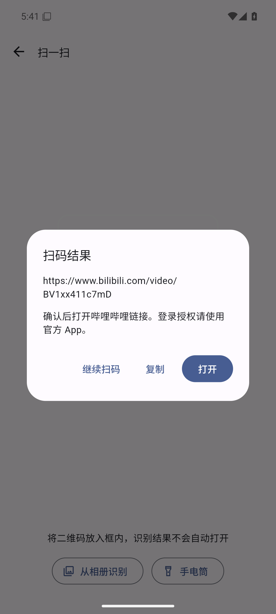
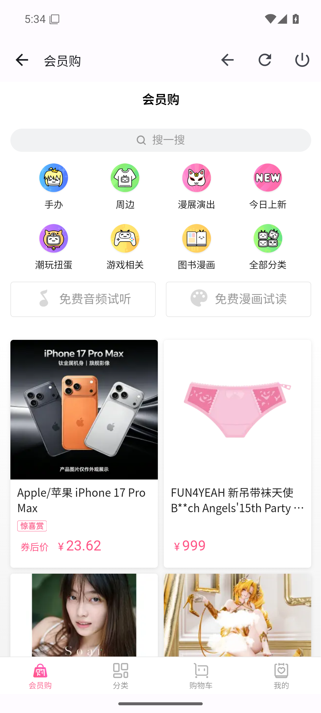
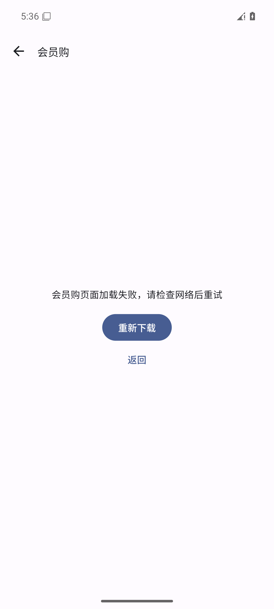

<div align="center">


# Pili--

**A familiar starting point, with room for personal experiments.**

A personal-interest fork of PiliPlus · Unofficial Bilibili client · Android first

[](docs/DEVELOPMENT.md)
[](docs/DEVELOPMENT.md)
[](LICENSE)

[简体中文](README.md) · [Get started](#get-started) · [Documentation](#documentation) · [Issues](https://github.com/Ktclat/Pili--/issues) · [Acknowledgements](docs/ACKNOWLEDGEMENTS.md)

</div>

## About

**Pili-- is an independently maintained, personal-interest fork of [PiliPlus](https://github.com/bggRGjQaUbCoE/PiliPlus)**, maintained by [Ktclat](https://github.com/Ktclat) for learning, personal use, and feature experiments. Android is the current focus for development and validation. Work progresses as personal time allows.

Video playback, danmaku, search, feeds, live streams, favorites, and offline caching come from upstream and its community. Pili-- builds on that foundation with its own changes, project name, Android application ID, issue tracker, and update source.

> This is not an official Bilibili client or an official release of PiliPlus, PiliPalaX, or PiliPala. Upstream attribution, copyright notices, and licenses are respected, with thanks to the original authors and contributors.

## What changes here

| Area | Current implementation |
| --- | --- |
| Familiar features | Retains upstream playback, danmaku, search, feeds, live streams, favorites, and offline caching. Availability still depends on service APIs and account permissions. |
| QR scanning | Camera and gallery entry points on Home and My pages; recognizes QR content including BV / av identifiers. Results are shown before the user chooses to open or copy them. |
| Optional mall | Loads the official Bilibili mall website after opting in from My page. Includes retry, toolbar browser-back, refresh, and disable controls. Home does not preload it; leaving the page releases its WebView. |
| Account and network boundaries | Restricts account-bearing requests and redirects; removes certificate-validation bypasses, private-directory export, and the integration that passed login cookies to a third-party app. See [security scope](SECURITY.md). |
| Resource use | Stops the camera in the background, reuses web caches, and limits automatic retries to GET / HEAD requests to reduce duplicate writes. |
| Independent maintenance | Uses Android application ID `io.github.ktclat.piliminus`. Source links, issue reporting, and update checks point to this repository. |

These describe implemented behavior, not comprehensive acceptance results. See the [validation record](docs/VALIDATION.md) for the tested environment, results, and gaps. Planned or unmerged changes are not counted as existing features.

## Screenshots

These screenshots come from the existing **2026-10-27 Android emulator acceptance session**. The [historical validation record](docs/VALIDATION.md) describes the environment and observed results.

| QR result confirmation | On-demand mall | Offline and retry state |
| :---: | :---: | :---: |
|  |  |  |

See [acknowledgements](docs/ACKNOWLEDGEMENTS.md) for the inherited icon's source.

## Get started

### Installation packages

- **Published builds:** use the actual attachments and notes in [this repository's Releases](https://github.com/Ktclat/Pili--/releases). If none are available, build from source.
- **Development builds:** successful [Actions runs](https://github.com/Ktclat/Pili--/actions/workflows/build.yml) may provide downloadable artifacts. The current workflow produces test-signed APKs, and artifacts expire; they are not production releases.
- **Build from source:** follow the [development guide](docs/DEVELOPMENT.md) for setup, signing, and troubleshooting.

The separate Android application ID distinguishes the installation and its data. Login details, settings, and cached content are not migrated automatically from upstream apps. Link handling and launcher shortcuts when both apps are installed require validation for the specific build.

### Quick Android build

Install Git, **PowerShell 7**, JDK 17, and Android SDK 37. Run the following in PowerShell. The [development guide](docs/DEVELOPMENT.md) covers Linux host libraries, Android SDK setup, and Windows path issues.

```powershell
git clone https://github.com/Ktclat/Pili--.git
cd Pili--
git clone --depth 1 --branch 3.47.8 https://github.com/flutter/flutter.git .tools/flutter
./scripts/prepare_android.ps1
$env:PUB_CACHE = Join-Path $PWD '.tools/pub-cache'
$version = [regex]::Match((Get-Content pubspec.yaml -Raw), '(?m)^version:\s*([0-9.]+)\+([0-9]+)\s*$')
if (-not $version.Success) { throw 'Check the version in pubspec.yaml.' }
./.tools/flutter/bin/flutter build apk --release --split-per-abi --no-pub `
  "--dart-define=pili.name=$($version.Groups[1].Value)" `
  "--dart-define=pili.code=$($version.Groups[2].Value)"
```

APKs are written to `build/app/outputs/flutter-apk/`. The project depends on upstream Flutter patches, so use the isolated `.tools/flutter` checkout and preparation script. The command reads the version from `pubspec.yaml` and uses it for the About page. See the development guide to include the commit hash, build time, and other build metadata.

Without your own signing configuration, even release-mode APKs use a test signature. Distribution requires appropriate signing, matching source and build materials, and acceptance checks on the installed APK.

## Before using

- **Android is the validation focus.** Retained iOS, desktop, and other platform sources do not establish verified support or a release commitment.
- **The mall is the official H5 website.** Activation downloads HTML, JavaScript, images, and related resources through the system WebView. It is not an installable APK / DEX plugin. Real orders and payments have not completed acceptance testing.
- **Scanned content does not execute automatically.** Text and unsupported schemes can only be copied; external websites open in the system browser after confirmation. Use the official app for QR login authorization.
- **This client uses online services.** Video and account features rely on Bilibili; update checks use GitHub. Optional services and data boundaries are described in [SECURITY.md](SECURITY.md).
- **No paid-content or membership bypass is provided.** Access depends on the service, account eligibility, and applicable rules.

## Documentation

Most detailed guides below are currently written in Chinese; NOTICE and LICENSE are in English.

| Document | Purpose |
| --- | --- |
| [FAQ](docs/FAQ.md) | Upstream relationship, inherited contributors, coexistence, scanning, mall behavior, and version identification |
| [Development guide](docs/DEVELOPMENT.md) | Environment, analysis and tests, Android builds, signing, repository layout, and troubleshooting |
| [Contributing](CONTRIBUTING.md) | Bug reports, feature proposals, changes, and upstream synchronization |
| [Validation](docs/VALIDATION.md) | Historical acceptance results, screenshots, APK hashes, and untested areas |
| [Security](SECURITY.md) | Hardened boundaries, network and data behavior, and vulnerability reporting |
| [Acknowledgements](docs/ACKNOWLEDGEMENTS.md) | Upstream projects, historical contributors, dependencies, and assets |
| [NOTICE](NOTICE) / [LICENSE](LICENSE) | Source attribution, modification notices, and license text |

## Feedback and contributions

Report problems and ideas in **[Pili-- Issues](https://github.com/Ktclat/Pili--/issues)** after checking the [FAQ](docs/FAQ.md). Include a version or commit, device information, and reproducible steps. Keep fork-specific reports here so upstream maintainers are not asked to support changes they do not maintain.

See [CONTRIBUTING.md](CONTRIBUTING.md) before submitting code or documentation. This is a hobby project with no fixed release schedule.

## Acknowledgements and license

Thank you to **[PiliPlus](https://github.com/bggRGjQaUbCoE/PiliPlus)** for the direct codebase, and to **[PiliPala](https://github.com/guozhigq/pilipala)**, **[PiliPalaX](https://github.com/orz12/PiliPalaX)**, and their contributors for the work behind it. Thanks also to [bilibili-API-collect](https://github.com/SocialSisterYi/bilibili-API-collect), [Flutter](https://github.com/flutter/flutter), [media-kit](https://github.com/media-kit/media-kit), and the wider dependency community. See the [full acknowledgements](docs/ACKNOWLEDGEMENTS.md).

The project retains upstream's [GPL v3 license](LICENSE), alongside applicable file-level and third-party licenses. Follow those terms when modifying or redistributing, including the corresponding source and build-material requirements. “Personal-interest” describes the project's purpose and adds no license restriction. See [NOTICE](NOTICE).
