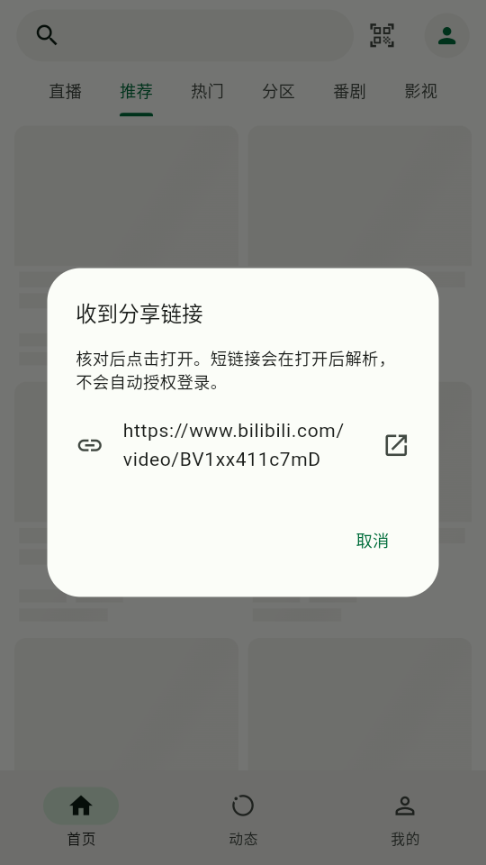
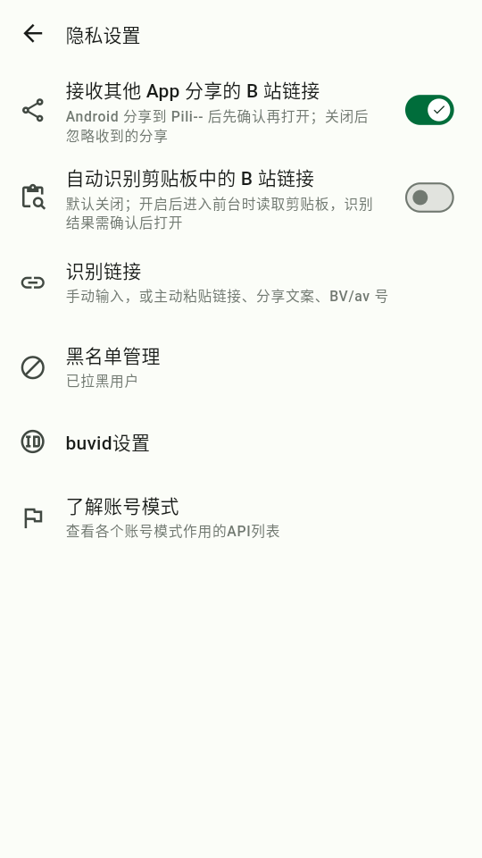
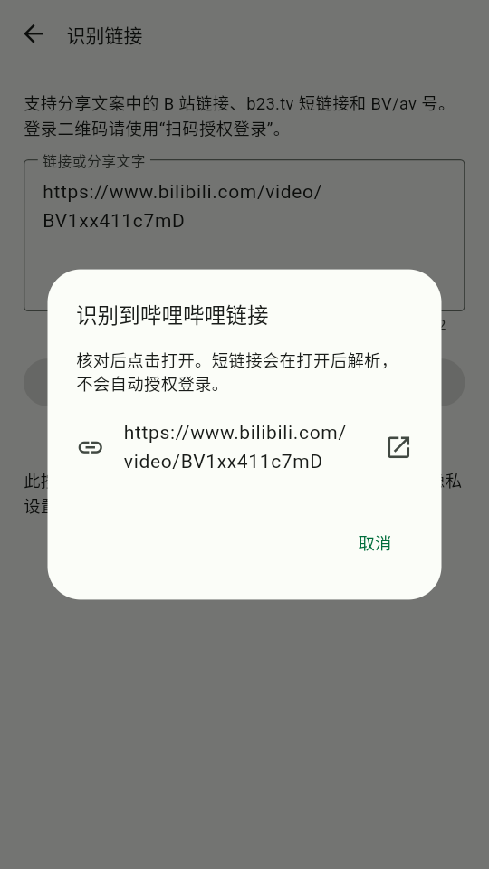

# 0.5.0+6 验证证据

[验证记录](../VALIDATION.md) · [输入与授权说明](../INPUT_RECOGNITION.md) · [仓库重建](../REPOSITORY_RESTART.md)

验证日期：2026-10-30。以下结果仅对应源码根提交 [`371b81a8e862fa83cee3dc5ac029b6814259e38b`](https://github.com/Ktclat/Pili--/commit/371b81a8e862fa83cee3dc5ac029b6814259e38b)。后续仅补充本记录的文档提交不改变所测业务代码。

## 自动检查与构建

| 检查 | 结果 |
| --- | --- |
| Flutter 回归 | 278 项通过 |
| 静态分析 | 0 error、0 warning，39 条已有上游 info；使用 `--no-fatal-infos` |
| Python 身份检查器 | 10 项通过 |
| CI | [Actions #25](https://github.com/Ktclat/Pili--/actions/runs/40985731174)，全部 14 个步骤成功 |
| Android 构建 | `armeabi-v7a`、`arm64-v8a`、`x86_64` 三架构均成功 |
| 实际 APK 身份 | 三个 APK 均通过包名、Provider、快捷方式与上游隔离检查 |

CI 测试附件为 [Pili--Android-test-signed](https://github.com/Ktclat/Pili--/actions/runs/40985731174/artifacts/12947293758)，需登录 GitHub，预定于 2026-11-13 到期；到期后应从后续成功构建获取测试包。这不是正式签名的 Release，不保证不同 CI 构建可以覆盖安装。

CI 附件摘要：`sha256:bd1fe584af5fbb298aadb533ded7b999d6afe9ab535f634c9f212cc34133fa6a`。下述设备使用同一源码的**本地 x86_64 构建**，不是 CI 附件中的 APK，其 SHA-256 为 `ce5f1ee71ff1ad5bf42cf6a43abdeee041855f6f131d8060b7ba793830eb269b`；版本名 `0.5.0`、版本号 `6`、包名 `io.github.ktclat.piliminus`。

## Android 模拟器

设备为 Android 11 / API 30 / x86_64 AOSP ATD，使用软件 CPU 与 SwiftShader，没有硬件虚拟化。使用原有游客环境，没有清除应用数据、卸载或登录真实账号；测试时降低模拟器显示分辨率以减少渲染负担。此环境不能支持真机性能结论。

| 场景 | 结果与范围 |
| --- | --- |
| 覆盖升级 | 从已安装的 0.2.0+3 执行 `adb install -r` 成功，安装后系统报告 0.5.0 / code 6；没有逐项核验旧业务数据 |
| 与 PiliPlus 共存 | Pili-- 与 `com.example.piliplus` 同时保持安装；仅验证安装身份，没有重新验收全部链接竞争行为 |
| 游客状态 | “我的”显示“点击登录”、0 级；没有读取账号存储或用户凭据 |
| 冷启动接收分享 | force-stop 后发送 `ACTION_SEND text/plain` 公共 BV 链接，出现“收到分享链接”原生确认，没有自动打开 |
| 热启动接收分享 | 同进程发送公共 av170001 链接，出现新的原生确认，没有自动打开 |
| 伪域名分享 | `https://bilibili.com.example.org/video/BV1xx411c7mD` 被忽略，没有弹窗或浏览器跳转 |
| 默认选项 | 接收分享开、自动剪贴板识别关；这是界面状态观察，禁用时零自动读取另由单元测试覆盖 |
| 关闭与恢复分享接收 | 关闭后合法 BV 分享被忽略；重新开启后再次出现确认；结束时恢复接收开、自动剪贴板关 |
| 手动输入与识别 | 从隐私页进入，实际输入公共 BV 链接并点击识别，出现原生确认，没有自动打开 |
| 确认打开后的内容 | 点击链接后显示“获取中…”，5 秒采样未进入视频详情；只确认进入获取流程，内容加载和播放未记为通过 |
| 扫码授权入口 | “我的”可见独立入口并可进入扫描页；相册假码至原生确认页的设备操作尚未完成 |
| 真实网页/TV 授权 | 未执行：没有真实账号、真实二维码或实际授权请求 |

## 界面证据

以下截图均来自上述游客环境，链接为公共演示视频，没有账号凭据或真实登录二维码。

| 冷启动分享确认 | 默认隐私选项 | 手动识别确认 |
| --- | --- | --- |
|  |  |  |

## 未覆盖与环境限制

模拟器和网络较慢，主页曾出现真实 API 连接超时；不把视频联网加载、播放或进入获取流程等同于内容成功。初次 UI 自动化受主页动画影响失败，后续使用独立输出路径和实际截图采证，没有复用失败轮次的旧 XML。

本次没有完成 ARM64 真机、长时间运行、真实账号扫码登录或网页/TV 授权。授权自动测试使用假账号、假密钥与响应适配器；公开官方 JS 契约和匿名 URL 格式研究不能代替实际授权验收。相册识别至授权页、官方额外验证、不同网络及系统版本仍需要后续验证。
