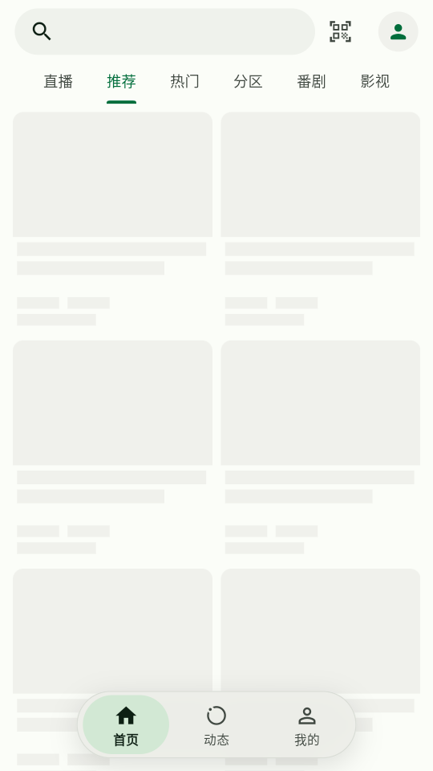
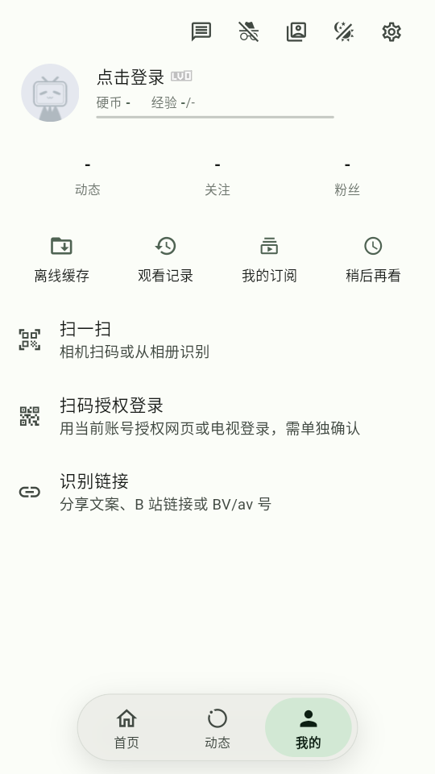

# 0.6.0+7 悬浮导航验证

[验证记录](../VALIDATION.md) · [悬浮导航说明](../FLOATING_NAVIGATION.md) · [预发布下载](https://github.com/Ktclat/Pili--/releases/tag/v0.6.0-beta.1)

验证日期：2026-11-05。业务源码为 [`8998b8fc8ee3edc649cebca05422cc78ca3e63b6`](https://github.com/Ktclat/Pili--/commit/8998b8fc8ee3edc649cebca05422cc78ca3e63b6)。

## 构建与发布

[构建 Actions](https://github.com/Ktclat/Pili--/actions/runs/41070378254) 的全部步骤成功：316 项 Flutter 测试、14 项 Python 检查、静态分析 0 error / 0 warning（39 条已有 info），以及三个 ABI 的构建和实际包身份检查。

[发布 Actions](https://github.com/Ktclat/Pili--/actions/runs/41997171383) 逐包核对版本、包名、ABI、内嵌源码与共同签名，再核对远程摘要后公开版本。Release 含三架构 APK、精确源码、`BUILD_INFO.json` 与 `SHA256SUMS.txt`。公开下载的构建信息与清单已核对一致，标签指向上述精确提交。它仍是测试签名预发布，不保证与旧 CI 包覆盖升级。

## 安装后的实际界面

设备为 Android 11 / API 30 / x86_64 AOSP ATD，软件 CPU 与 SwiftShader，没有硬件虚拟化。显示为 540×960、density 210；不能用于真机性能结论。保留原有游客环境，没有清除数据、卸载、登录账号或读取账号存储。

本次安装的是相同源码的本地 x86_64 APK，**不是 Release 的 CI APK**。SHA-256：`8bfdc47ad7ccd04800ae3deb0369d4d65648be11fd7d6e92b59603efd1ad3b19`；版本 `0.6.0`、code `7`，包名 `io.github.ktclat.piliminus`，已实读核对内嵌源码提交。

| 场景 | 实际结果与范围 |
| --- | --- |
| 覆盖安装 | 从已安装的 0.5.0/code 6 执行 `adb install -r` 成功；系统确认 0.6.0/code 7。仅说明这两个本地同签名包可升级，不代表 CI 包签名兼容，也未逐项核验旧业务数据 |
| 与上游共存 | Pili-- 升级后 `com.example.piliplus` 仍安装，未卸载上游 |
| 默认悬浮界面 | 实际首页截图和已选状态确认胶囊底栏默认显示，首页选中；没有为采证改写应用服务 |
| 游客页面与点击 | 点击“我的”进入游客页，显示“点击登录”，底栏选中“我的”；未执行真实账号操作 |
| 快速划过并立即松手 | 从“我的”拖向“首页”，实际注入移动约 149ms、末端约 14ms 即松手；后续 XML 仍为“我的”已选，页面保持游客个人页，没有补交切换 |
| 拖动后停稳 | 同样从“我的”拖向“首页”，末端停稳约 1236ms 后，实际 XML 为“首页”已选，新截图也显示首页；只证明长于阈值的停留可切页，不将其当作精确 200ms 测量或回调次数证明 |

## 截图

以下为该本地 APK 的实际新截图。首页内容尚在加载，不能由此认定视频内容联网或播放通过。

| 首页 | 游客“我的” |
| --- | --- |
|  |  |

## 验收边界

精确 200ms 阈值、累计移动重置、快速释放、连续停留提交、多指／失焦恢复、迟到指针、导航重排、隐藏、RTL、窄屏和大字号由组件与页面集成测试覆盖。软件模拟器上的少量真实操作不能代替真机系统手势竞争、帧率、长时间运行或所有触控边界验收。

设置内即时开关本轮没有在设备上重新操作，相关控制器与页面状态保留由集成回归覆盖，不记作设备通过。

ARM64 真机、真实账号网页／TV 扫码授权、长时间播放／下载仍未验收；未把旧版设备证据或自动测试算作本次 CI APK 的安装验收。
